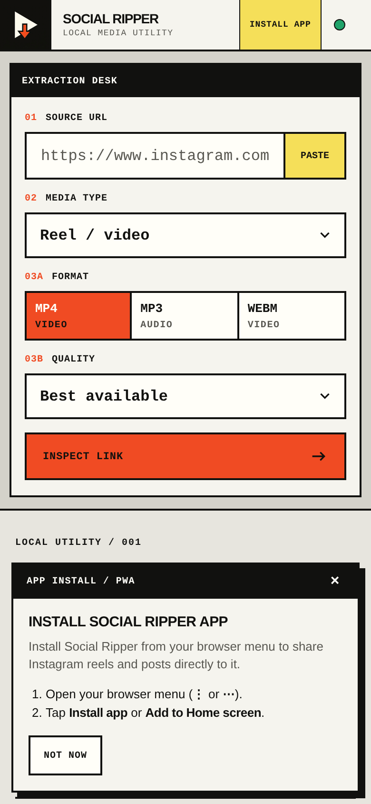

<p align="center">
  <a href="https://socialripper.space"></a>
</p>

<h1 align="center">Social Ripper</h1>

<p align="center">
  <strong>A self-hosted, privacy-respecting web app &amp; PWA for downloading public social media.</strong>
</p>

<p align="center">
  <a href="https://socialripper.space">Website</a> -
  <a href="#support">Donate</a> -
  <a href="#features">Features</a> -
  <a href="#what-is-social-ripper">Preview</a> -
  <a href="#mobile--pwa">PWA &amp; Share</a> -
  <a href="#self-hosting">Self-Hosting</a> -
  <a href="#troubleshooting">Troubleshooting</a>
</p>

<p align="center">
  <a href="https://github.com/Dipak-Chauhan/SocialRipper/stargazers"></a>&nbsp;<a href="https://github.com/Dipak-Chauhan/SocialRipper/network/members"></a>&nbsp;<a href="https://github.com/Dipak-Chauhan/SocialRipper/issues"></a>
</p>

<p align="center">
  <a href="https://ko-fi.com/dipakchauhan"></a>&nbsp;&nbsp;<a href="https://buymeacoffee.com/dipakchauhan"></a>
</p>

---

## What is Social Ripper?

**Social Ripper** is a minimal, local-first utility for saving public reels, videos, audio tracks, photos, and multi-image carousels directly from your browser or mobile share sheet. No accounts, no third-party uploads, and no artificial file-size caps—just paste or share a link, inspect the preview, and stream the file straight to your device.

> **Download only media you own or have permission to save.** Platform restrictions still apply.

<p align="center">
  
</p>

<table align="center">
  <tr>
    <td align="center">
      <br>
      <sub>Source Preview &amp; Streaming Download</sub>
    </td>
    <td align="center">
      <br>
      <sub>Mobile-First Extraction Desk &amp; PWA Install</sub>
    </td>
  </tr>
</table>

<p align="center">
  <sub>Preview sample © 2008 Blender Foundation · <a href="https://peach.blender.org/about/">Big Buck Bunny license</a></sub>
</p>

---

## Features

### Media & Quality

| Media | Output | Options |
| --- | --- | --- |
| Video or reel | MP4, WebM | Best available, 1080p, 720p, or 480p (stream-copies native containers or recodes via FFmpeg when needed) |
| Audio from a video | MP3 | 320, 192, or 128 kbps |
| Image post | JPG, PNG, WebP | First image sanitized &amp; converted via FFmpeg (`mjpeg -q:v 2`, lossless `png`, `libwebp -quality 90`) |
| Carousel | ZIP | Up to 20 images in the chosen image format packaged as a `store`-mode ZIP |

- **No artificial file-size limit:** Downloads have no 250 MB cap and are bounded only by available disk space and upstream platform limits.
- **Zero-RAM browser streaming:** Two-phase downloads (`POST /api/downloads` → one-time `GET /api/downloads/:token`) stream large files directly to disk without buffering them in browser memory.
- **Unicode filenames:** Preserves non-ASCII media titles using RFC 5987 `filename*=UTF-8''...` with clean ASCII fallbacks.

### Supported Platforms

- **Instagram** (`instagram.com`)
- **TikTok** (`tiktok.com`)
- **YouTube** (`youtube.com`, `youtu.be`)
- **Facebook** (`facebook.com`, `fb.watch`)
- **X / Twitter** (`x.com`, `twitter.com`)
- **Threads** (`threads.net`, `threads.com`)
- **Vimeo** (`vimeo.com`)
- **Reddit** (`reddit.com`, `redd.it`)
- **Pinterest** (`pinterest.com`, `pin.it`)

### Mobile & PWA

- **Zero-scroll mobile layout:** On phones and tablets (`<= 1020px`), the Extraction Desk moves directly to the top under a compact masthead so you can paste and inspect without scrolling.
- **Installable PWA:** Non-blocking **Install Social Ripper** bottom popup (7-day dismiss cooldown) plus a persistent **INSTALL APP** header button for native installation on Android/Desktop Chromium and **Add to Home Screen** guidance on iOS Safari.
- **Direct Android Share Target:** Registered on `/share-target`—share a Reel or post from Instagram, TikTok, YouTube, X, Reddit, or Pinterest straight to **SocialRipper** to extract the URL from captions, auto-inspect immediately (with automatic image/carousel fallback when `gallery-dl` is present), and download in one tap.
- **Query URL launch:** Supports `/?url=<encoded-link>` for iOS Apple Shortcuts and bookmarklets.

### Privacy & Reliability

- **Local-first & tracker-free:** Zero analytics, zero accounts, and zero third-party server uploads.
- **Strict origin & CSP hardening:** Enforces same-origin validation (`Host`, `Origin`, `Sec-Fetch-Site`), DNS-rebinding guards, `object-src 'none'`, `no-referrer`, and `gallery-dl` / `ffmpeg` sandbox flags (`-protocol_whitelist file`, `--ignore-config`).
- **Live tool status & graceful cancellation:** Displays `ENGINE ONLINE`, `VIDEO / AUDIO ONLY` (automatically disabling image/carousel modes when `gallery-dl` is absent), or `ENGINE UNAVAILABLE`. In-UI **Cancel**, client disconnects, and `SIGINT`/`SIGTERM` shutdown terminate full child process groups and clean up temporary files.
- **Stream-safe Service Worker:** `sw.js` caches the static app shell while bypassing all `/api/*` paths so media inspection and streaming downloads are never intercepted.

---

## Usage

### Live Instance

Try the hosted PWA directly at **[socialripper.space](https://socialripper.space)**.

### Desktop & Mobile Browser

1. Paste a public HTTPS URL (or tap **PASTE**) and choose **Reel / video**, **Image post**, or **Carousel (ZIP)**.
2. Select your container (`MP4`, `MP3`, `WEBM`, `JPG`, `PNG`, `WEBP`) and quality, then tap **Inspect link**.
3. Confirm the source preview and tap **Download** (or tap **Cancel** to abort mid-flight).

### Direct Sharing on Mobile (PWA)

1. Serve Social Ripper over **HTTPS** and install it via the **Install Social Ripper** popup (Android/Chrome/Edge) or **Share → Add to Home Screen** (iOS Safari).
2. On Android, open **Instagram**, **TikTok**, **YouTube**, **X**, **Reddit**, or **Pinterest**, tap **Share**, and select **SocialRipper**—the link fills in and inspects automatically.

> **HTTPS requirement:** Mobile browsers only trigger native PWA install prompts and Android Share Sheet registration over HTTPS (local desktop browsers also allow `http://127.0.0.1` and `http://localhost`).

---

## Self-Hosting

### Prerequisites

- **Node.js 20+**
- **Python** on Unix for the bundled `yt-dlp` launcher ([yt-dlp dependencies](https://github.com/yt-dlp/yt-dlp#dependencies))
- **[gallery-dl](https://github.com/mikf/gallery-dl#installation)** on `PATH` (or via `GALLERY_DL_BIN`) if you want photo post & carousel support

### Local Installation

```bash
git clone https://github.com/Dipak-Chauhan/SocialRipper.git
cd SocialRipper
npm ci
npm start
```

Open [http://127.0.0.1:3000](http://127.0.0.1:3000). Check `/api/health` to verify binary availability, and run `npm test` to execute the test suite.

### Environment Variables

| Variable | Purpose |
| --- | --- |
| `HOST` / `PORT` | Listen address and port. Defaults to `127.0.0.1:3000`. Binding `0.0.0.0` or `::` allows direct LAN IP access while still rejecting arbitrary DNS-rebinding hostnames. |
| `ALLOWED_HOSTS` | Comma-separated public hostnames allowed by the same-origin check (e.g. `media.example.com`). |
| `DOWNLOAD_TIMEOUT_MS` | Maximum time in milliseconds per download/conversion job (shared deadline across carousel images). Defaults to `3600000` (60 minutes). |
| `PENDING_DOWNLOAD_TTL_MS` | Time in milliseconds before an unclaimed one-time `/api/downloads/:token` URL expires and cleans up its temp directory. Defaults to `60000` (60 seconds). |
| `YT_DLP_BIN` / `FFMPEG_BIN` | Override paths for `yt-dlp` and `ffmpeg` executables. |
| `GALLERY_DL_BIN` | Path to `gallery-dl` when installed outside `PATH` and `node_modules/.bin`. |
| `YT_DLP_COOKIES_FILE` / `GALLERY_DL_COOKIES_FILE` | Path to a Netscape-format `cookies.txt` file passed to `yt-dlp` or `gallery-dl` via an isolated per-job temp copy (`0600`). Useful when platforms enforce bot checks or login walls on cloud VPS IPs. |
| `YT_DLP_PROXY` / `GALLERY_DL_PROXY` | Optional HTTP/HTTPS/SOCKS proxy URL passed via `--proxy` to `yt-dlp` or `gallery-dl`. |
| `YT_DLP_JS_RUNTIMES` | Optional `yt-dlp --js-runtimes` value (for example `node` when `deno` is not installed on the server). |

### Public Deployment (Reverse Proxy)

1. Run `npm ci` and `npm start` as a persistent Node.js service with outbound HTTPS access and writable temporary storage.
2. Keep the Node.js port private behind an HTTPS reverse proxy (Nginx, Caddy, Cloudflare Tunnel, or Tailscale HTTPS). Set `ALLOWED_HOSTS=media.example.com` (or rewrite `Host` and `Origin` at the proxy to match the upstream address).
3. Rate-limit `/api/info`, `/api/download`, and `/api/downloads` at the proxy and disable proxy buffering on `/api/downloads/` for streaming downloads.

<details>
<summary>Nginx configuration example</summary>

Add the rate-limit zone inside Nginx's `http` block:

```nginx
limit_req_zone $binary_remote_addr zone=social_ripper:10m rate=12r/m;
```

Add the following to your HTTPS `server` block (replacing `media.example.com` with your public hostname):

```nginx
server_name media.example.com;

if ($host != media.example.com) {
    return 421;
}

location / {
    proxy_pass http://127.0.0.1:3000;
}

location ~ ^/api/(info|download|downloads)$ {
    if ($http_origin != "https://media.example.com") {
        return 403;
    }

    limit_req zone=social_ripper burst=4 nodelay;
    limit_req_status 429;

    proxy_pass http://127.0.0.1:3000;
    proxy_set_header Host 127.0.0.1:3000;
    proxy_set_header Origin http://127.0.0.1:3000;
    proxy_read_timeout 60m;
    proxy_buffering off;
}

location ^~ /api/downloads/ {
    proxy_pass http://127.0.0.1:3000;
    proxy_set_header Host 127.0.0.1:3000;
    proxy_set_header Origin http://127.0.0.1:3000;
    proxy_buffering off;
    proxy_max_temp_file_size 0;
    proxy_read_timeout 60m;
}
```

Test with `nginx -t` before reloading ([Nginx proxy docs](https://nginx.org/en/docs/http/ngx_http_proxy_module.html) · [Rate limiting](https://nginx.org/en/docs/http/ngx_http_limit_req_module.html)).

</details>

### Architecture & API

- `GET /api/health` — Returns readiness (`200` / `503`) and availability of `yt-dlp`, `ffmpeg`, and `gallery-dl`.
- `POST /api/info` — Fetches sanitized metadata (`title`, `uploader`, `platform`, `duration`, `thumbnail`, `width`, `height`, `itemCount`).
- `POST /api/downloads` → `GET /api/downloads/:token` — Prepares media into a temp directory, reserves a job slot until transfer ends or `PENDING_DOWNLOAD_TTL_MS` elapses, and streams the file or ZIP via a one-time token.
- `POST /api/download` — Direct single-request streaming download endpoint.
- `GET /share-target`, `/manifest.webmanifest`, `/sw.js`, `/icons/*.png` — PWA manifest, icons, service worker, and Android Web Share Target entry point.

---

## Troubleshooting

| Symptom | What to check |
| --- | --- |
| Engine unavailable or HTTP 503 | Visit `/api/health` and confirm `yt-dlp` and `ffmpeg` are executable on the host. |
| Image options disabled or fail | Confirm `gallery-dl` is available on `PATH`, `node_modules/.bin`, or `GALLERY_DL_BIN`, and that the link exposes public images. |
| Install prompt or Android Share Sheet missing | Mobile browsers require HTTPS for PWA installation and Web Share Target. Confirm `/manifest.webmanifest` and `/sw.js` return `200`. |
| HTTP 403 on LAN or behind a reverse proxy | Bind `HOST=0.0.0.0` for direct LAN IP access; behind a reverse proxy set `ALLOWED_HOSTS=<hostname>` or verify upstream `Host` and `Origin` headers. |
| HTTP 404 when saving a file | One-time `/api/downloads/:token` links expire after single use or `PENDING_DOWNLOAD_TTL_MS`. Click **Download** again. |
| HTTP 429 | Both shared job slots are active, or the reverse proxy's rate limit was reached. Wait briefly and retry. |
| Public videos fail with bot-check or rate-limit errors on a cloud VPS | Cloud datacenter IPs (Oracle Cloud, AWS, etc.) often trigger platform bot checks or rate limits. Set `YT_DLP_COOKIES_FILE` (plus `YT_DLP_JS_RUNTIMES=node` if `deno` is absent) or `YT_DLP_PROXY`, and `GALLERY_DL_COOKIES_FILE` or `GALLERY_DL_PROXY`, then restart the service. |

---

## Support

Social Ripper is free and open-source with zero ads or tracking. If it saves you time, consider supporting hosting and ongoing maintenance:

<p align="center">
  <a href="https://ko-fi.com/dipakchauhan"></a>&nbsp;&nbsp;<a href="https://buymeacoffee.com/dipakchauhan"></a>
</p>

---

<p align="center">
  Made for fast, local, private media archiving
</p>

## Star History

<a href="https://www.star-history.com/#Dipak-Chauhan/SocialRipper&type=date&logscale&legend=top-left">
 <picture>
   <source media="(prefers-color-scheme: dark)" srcset="https://api.star-history.com/svg?repos=Dipak-Chauhan/SocialRipper&type=date&theme=dark&logscale&legend=top-left" />
   <source media="(prefers-color-scheme: light)" srcset="https://api.star-history.com/svg?repos=Dipak-Chauhan/SocialRipper&type=date&theme=light&logscale&legend=top-left" />
   
 </picture>
</a>
