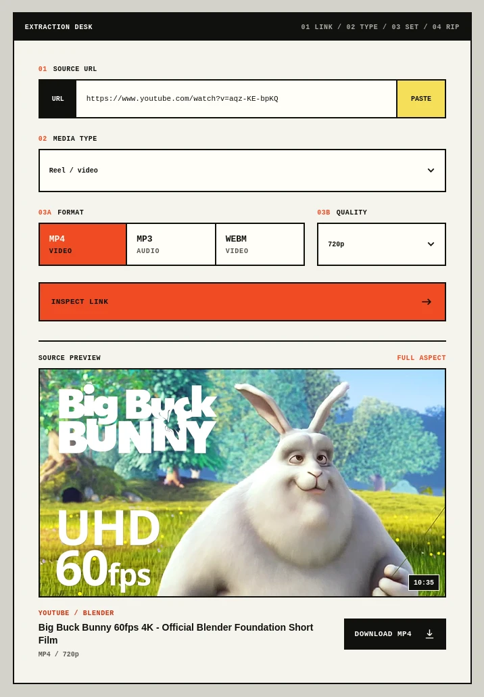

# Social Ripper

Download video, audio, and images from public social media links. Inspect the source, choose an output, and save the file.


## What you can save

- **Video and audio** · MP4, WebM, or MP3 with quality controls.
- **Images** · JPG, PNG, or WebP. Save a single image or up to 20 images in a carousel ZIP.

Paste a public HTTPS link, choose the media type, and select **Inspect link**. Review the preview, then download. Supported sources include Instagram, TikTok, YouTube, Facebook, X, Threads, Vimeo, Reddit, and Pinterest. Available formats vary by source. Downloads are limited to 250 MiB.



*Preview sample © 2008 Blender Foundation. [Big Buck Bunny license](https://peach.blender.org/about/).*

**Download only media you own or have permission to save.** Platform restrictions still apply.

## Run locally

Use Node.js 20 or newer. The bundled yt-dlp launcher on Unix needs [a supported Python version](https://github.com/yt-dlp/yt-dlp#dependencies). Install [gallery-dl](https://github.com/mikf/gallery-dl#installation) on your `PATH` for image posts and carousels.

```bash
git clone https://github.com/Dipak-Chauhan/social-ripper.git
cd social-ripper
npm ci
npm start
```

Open [http://127.0.0.1:3000](http://127.0.0.1:3000). Use `/api/health` to check tool availability and `npm test` to run the tests. To use separately installed tools, set `YT_DLP_BIN`, `FFMPEG_BIN`, or `GALLERY_DL_BIN` to the executable path.

## Public deployment

Run `npm ci` and `npm start` on a Node.js host with outbound HTTPS access and writable temporary storage. The server listens on `127.0.0.1:3000` by default. Set `HOST` and `PORT` if your private network requires a different bind address or port. Each server process handles up to two concurrent media jobs.

Keep the Node.js port private behind an HTTPS reverse proxy. The API expects a matching HTTP `Host` and `Origin` upstream. Configure the proxy to accept only your public hostname and reject media requests with an origin other than your public HTTPS URL. Forward valid requests with the upstream `Host` and HTTP `Origin`, for example `127.0.0.1:3000` and `http://127.0.0.1:3000`.

Rate-limit `/api/info` and `/api/download` at the proxy. Verify link inspection and a download through the public URL before opening access.
