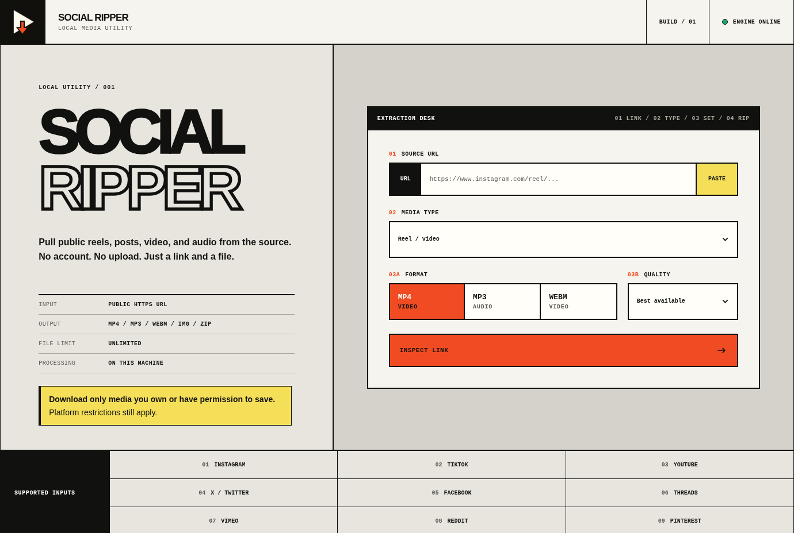

# Social Ripper

A self-hosted web app for saving video, audio, and images from public social media links. Preview the source, pick an output format, and download from your browser.



## Formats and sources

| Media | Output | Options |
| --- | --- | --- |
| Video or reel | MP4, WebM | Best available, or up to 1080p, 720p, or 480p |
| Audio from a video | MP3 | 320, 192, or 128 kbps |
| Image post | JPG, PNG, WebP | First available image from the post |
| Carousel | ZIP | Up to 20 images in the selected image format |

The app accepts public HTTPS links from Instagram, TikTok, YouTube, Facebook, X, Threads, Vimeo, Reddit, and Pinterest. Available formats depend on the source and its restrictions. Downloads are limited to 250 MiB.

**Download only media you own or have permission to save.** Platform restrictions still apply.

## Preview and download

1. Paste a public HTTPS link and choose **Reel / video**, **Image post**, or **Carousel (ZIP)**.
2. Select a format and quality, then click **Inspect link**.
3. Confirm the source in the preview and click **Download**.

<p align="center">
  
</p>

*Preview sample © 2008 Blender Foundation. [Big Buck Bunny license](https://peach.blender.org/about/).*

## Run locally

Use Node.js 20 or newer. On Unix, the bundled yt-dlp launcher also needs [a supported Python version](https://github.com/yt-dlp/yt-dlp#dependencies). For photos and carousels, install [gallery-dl](https://github.com/mikf/gallery-dl#installation) and make it available on your `PATH`.

```bash
git clone https://github.com/Dipak-Chauhan/social-ripper.git
cd social-ripper
npm ci
npm start
```

Open [http://127.0.0.1:3000](http://127.0.0.1:3000). Visit `/api/health` to check whether the server can find each executable. Run `npm test` for the backend tests.

| Environment variable | Purpose |
| --- | --- |
| `HOST` / `PORT` | Listen address and port. Defaults to `127.0.0.1:3000`. |
| `YT_DLP_BIN` / `FFMPEG_BIN` | Paths to separately installed binaries when overriding the bundled tools. |
| `GALLERY_DL_BIN` | Path to gallery-dl when it is installed outside `PATH` and `node_modules/.bin`. |

## How it works

The Node.js server serves the interface and keeps the app and API on the same origin. `POST /api/info` retrieves metadata for the preview. `POST /api/download` uses yt-dlp for video and audio, gallery-dl for images, and FFmpeg for conversion. Archiver streams carousel ZIPs.

Media processing uses the server's temporary storage. Inspection and download requests share two concurrent job slots per process. The server cancels work when a client disconnects and cleans up temporary files after the job.

## Public deployment

1. Run `npm ci` and `npm start` as a persistent Node.js service with outbound HTTPS access and writable temporary storage.
2. Keep the Node.js port private and put the public hostname behind an HTTPS reverse proxy. Validate the public `Host` and `Origin` before forwarding media requests with the matching HTTP upstream values.
3. Rate-limit `/api/info` and `/api/download` at the proxy. Check `/api/health`, then inspect and download a sample through the public HTTPS URL.

<details>
<summary>Nginx configuration example</summary>

Add the rate-limit zone inside Nginx's `http` block.

```nginx
limit_req_zone $binary_remote_addr zone=social_ripper:10m rate=12r/m;
```

Add the following to your HTTPS `server` block. Replace `media.example.com` with your public hostname and adjust the upstream address and port to match Node.js.

```nginx
server_name media.example.com;

if ($host != media.example.com) {
    return 421;
}

location / {
    proxy_pass http://127.0.0.1:3000;
}

location ~ ^/api/(info|download)$ {
    if ($http_origin != "https://media.example.com") {
        return 403;
    }

    limit_req zone=social_ripper burst=4 nodelay;
    limit_req_status 429;

    proxy_pass http://127.0.0.1:3000;
    proxy_set_header Host 127.0.0.1:3000;
    proxy_set_header Origin http://127.0.0.1:3000;
    proxy_read_timeout 12m;
    proxy_buffering off;
}
```

Test the configuration with `nginx -t` before reloading. [Nginx proxy directives](https://nginx.org/en/docs/http/ngx_http_proxy_module.html) · [Request limiting](https://nginx.org/en/docs/http/ngx_http_limit_req_module.html)

</details>

### Troubleshooting

| Symptom | What to check |
| --- | --- |
| Engine unavailable or HTTP 503 | Check `/api/health` and confirm yt-dlp and FFmpeg are executable on the host. |
| Image options fail | Confirm `gallery-dl` is available and the source exposes downloadable images. |
| HTTP 403 after deploying | Check the browser's public HTTPS origin and the upstream `Host` and `Origin` headers. |
| HTTP 429 | Both job slots may be busy, or the proxy's rate limit may have been reached. Retry after a short wait. |
